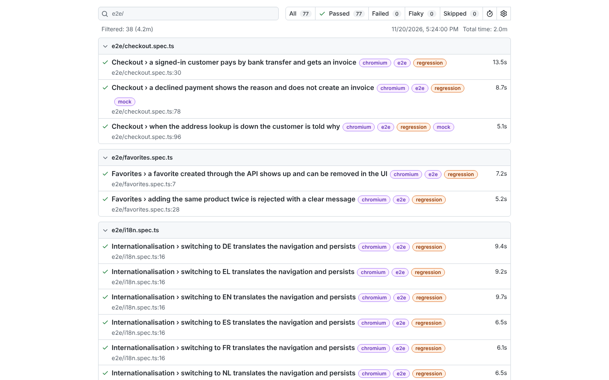
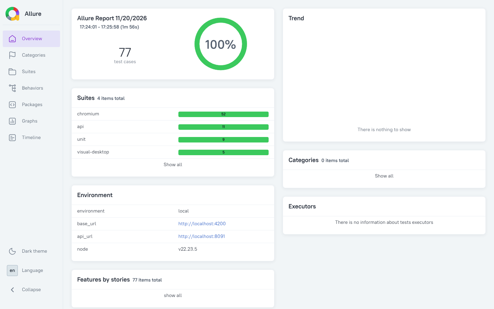
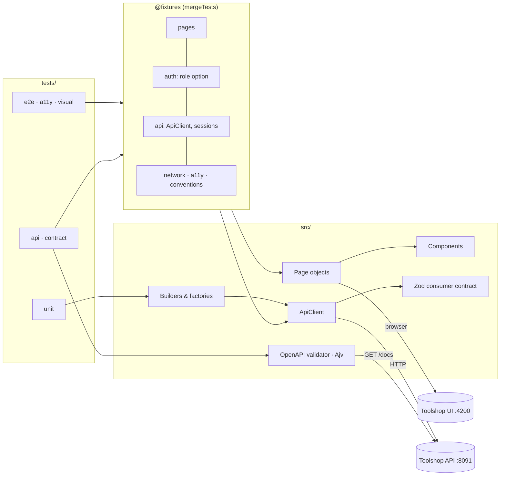
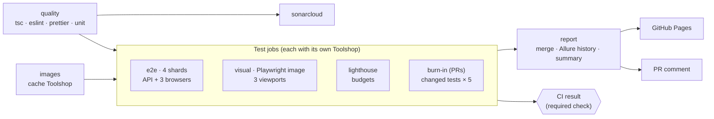

# playwright-ts-framework

[](https://github.com/Dyplox/playwright-ts-framework/actions/workflows/ci.yml)
[](https://github.com/Dyplox/playwright-ts-framework/actions/workflows/nightly.yml)
[](https://sonarcloud.io/summary/new_code?id=Dyplox_playwright-ts-framework)
[](https://dyplox.github.io/playwright-ts-framework/)


[](LICENSE)

End-to-end test framework built with **Playwright + TypeScript** against
[Practice Software Testing – Toolshop](https://practicesoftwaretesting.com), a realistic Angular + Laravel
e-commerce app made for test automation practice.

It is designed to show **architecture and engineering judgement**, not just a list of passing tests:
composable fixtures, data created through the API, API login with `storageState`, consumer and provider API
contracts, network mocking, accessibility (axe, keyboard and Lighthouse budgets), visual regression on three
viewports and a CI pipeline that shards, detects flaky tests and publishes its reports.

**Live reports:** [Playwright · Allure · Lighthouse](https://dyplox.github.io/playwright-ts-framework/) ·
**Design decisions:** [`docs/adr`](docs/adr)

| Playwright report                                            | Allure                                              |
| ------------------------------------------------------------ | --------------------------------------------------- |
|  |  |

## What is covered

| Suite          | Tag         | What it shows                                                                                                            | Runs on                          |
| -------------- | ----------- | ------------------------------------------------------------------------------------------------------------------------ | -------------------------------- |
| Smoke          | `@smoke`    | Catalog vs API, search, product detail, cart badge, API login + `storageState`, login form, API health                   | API + 3 browsers                 |
| E2E flows      | `@e2e`      | Checkout to invoice, 5 payment methods + 6 validation cases (data-driven), guest checkout, favorites, roles, 7 languages | 3 browsers                       |
| Network mocks  | `@mock`     | Declined payment, address-lookup outage, empty catalog, slow catalog (skeletons), add-to-cart error                      | 3 browsers                       |
| API contract   | `@contract` | Responses validated against the published OpenAPI 3.2; error shapes; spec drift; documented gaps                         | API                              |
| Access control | `@api`      | Customer vs admin permissions (UI redirects + API 403s), one known authorization defect as `test.fail()`                 | API + 3 browsers                 |
| Accessibility  | `@a11y`     | axe WCAG 2.1 AA on 10 pages/states, keyboard-only flows and visible focus, exceptions kept honest                        | Chromium                         |
| Visual         | `@visual`   | `toHaveScreenshot` of 4 pages + the responsive header                                                                    | Chromium × mobile/tablet/desktop |
| Unit           | `@unit`     | Framework internals: builders, JWT helpers, axe classification                                                           | Node (no browser)                |
| Lighthouse     | –           | Accessibility & best-practices gate; Core Web Vitals and weight budgets on 4 pages                                       | Chrome (Lighthouse CI)           |

**77 test definitions → 163 executions per pipeline** (functional suite × 3 engines, visual × 3 viewports).

## Architecture



## Engineering highlights

| Topic              | How it is done                                                                                                                                                                                                                   |
| ------------------ | -------------------------------------------------------------------------------------------------------------------------------------------------------------------------------------------------------------------------------- |
| Architecture       | Page objects + reusable components wired through fixtures (`test.extend` + `mergeTests`). Composition, no inheritance chains. A single import: `import { test, expect } from '@fixtures'`.                                       |
| Identity           | `test.use({ role: 'customer' \| 'admin' })`: the browser starts signed in through the API. Only the login tests use the login form ([ADR 2](docs/adr/0002-api-login-with-per-worker-sessions.md)).                               |
| Short-lived tokens | Toolshop JWTs live 5 minutes, so each worker renews its session when the token is about to expire instead of relying on a one-off setup project.                                                                                 |
| Isolation          | Locally every worker registers **its own customer** through the API: carts, favorites and invoices never collide between parallel workers or shards.                                                                             |
| API contracts      | Every API call is parsed with a Zod **consumer** contract (types inferred from it); a **provider** suite validates live responses against the published OpenAPI ([ADR 3](docs/adr/0003-consumer-and-provider-api-contracts.md)). |
| Test data          | `UserBuilder` (always-valid defaults with Faker), factories that persist through the API, data-driven tables (payments, languages) and catalog queries that keep guard clauses out of specs.                                     |
| Network control    | `page.route` mocks for states the backend can't produce on demand; an auto fixture blocks analytics. The happy path never fakes data the backend re-validates.                                                                   |
| Known defects      | Accessibility exceptions, API contract gaps and behaviour bugs (`test.fail()`) are scoped, explained and re-verified on every run ([ADR 4](docs/adr/0004-known-defects-as-code.md)).                                             |
| Visual stability   | Fonts/images awaited, animations off, volatile widgets hidden via `stylePath`, baselines rendered in the pinned Playwright image ([ADR 5](docs/adr/0005-visual-baselines-in-the-pinned-playwright-image.md)).                    |
| Conventions        | An auto fixture fails any test without a registered tag; ESLint (`typescript-eslint` type-checked + `eslint-plugin-playwright`) forbids conditionals, hard waits and unscoped skips.                                             |
| Triage             | Allure categories split failures into product defects, test defects, infrastructure, visual, accessibility and contract issues.                                                                                                  |

### Defects found in Toolshop by this suite

- **Security:** anonymous users can create products (`POST /products` → 201 without a token).
- **Accessibility:** icon-only password toggle without a name (4.1.2), label/name mismatches on the language
  switcher and cart link (2.5.3), broken list structure in filters and the password helper (1.3.1).
- **API contract:** undocumented `401` (login) and `422` (register) responses; `null` pagination fields typed as
  `integer`.
- **Search:** product names with words under 3 characters can't be found by their full name (MariaDB FULLTEXT).

## CI/CD



- **Triggers:** push to `main`, pull requests, manual run with a tag filter (`@smoke`, `@e2e`, `@mock`, `@a11y`,
  `@contract`) and a **nightly** full regression ([`nightly.yml`](.github/workflows/nightly.yml)).
- **Images cached once per pipeline:** Toolshop's Docker images are pulled/built by the `images` job and restored
  by every other job (faster, and no Docker Hub rate limits). Shared setup lives in composite actions
  ([`.github/actions`](.github/actions)).
- **Flaky detection:** on PRs, every test affected by the change (`--only-changed`, import graph included) runs
  5 times without retries; any flake fails the PR.
- **Reporting:** blob reports from every shard and the visual job are merged into one HTML report; Allure keeps
  its history by restoring it from the published site; a Markdown summary (totals per project, failures, flaky,
  Lighthouse scores, documented exceptions) goes to the job summary and as a sticky PR comment.
- **Single required check:** `CI result` is green only if every suite passed, which keeps branch protection
  simple.
- **Dependabot** groups weekly updates (Playwright, lint/types, reporting, test libraries, GitHub Actions).

### One-time repository setup

1. **Pages:** Settings → Pages → Source: **GitHub Actions**.
2. **SonarCloud:** import the repo (organization `dyplox`, key `Dyplox_playwright-ts-framework`, or edit
   [`sonar-project.properties`](sonar-project.properties)), disable "Automatic Analysis" and add the
   `SONAR_TOKEN` secret. Without it the job is skipped with a notice.
3. **Let workflows open PRs** (needed by _Update visual baselines_):
   ```bash
   gh api -X PUT repos/Dyplox/playwright-ts-framework/actions/permissions/workflow \
     -f default_workflow_permissions=read -F can_approve_pull_request_reviews=true
   ```
4. **Protect `main`** (changes only through PRs, required check `CI result`, no force-push or deletion):
   ```bash
   gh api -X POST repos/Dyplox/playwright-ts-framework/rulesets --input .github/rulesets/main.json
   ```

### Updating visual baselines

Run **Actions → Update visual baselines**. It renders the screenshots in the pinned Playwright image and:

- run on `main` → pushes them to a new `chore/visual-baselines-*` branch and opens a PR;
- run on your PR's branch → commits them to that branch.

In both cases it then dispatches CI on that branch, so the PR gets its required `CI result` check (pushes made
with `GITHUB_TOKEN` don't trigger workflows, `workflow_dispatch` does). Review the PNG diffs before merging.

## Project structure

```
playwright-ts-framework/
├── src/
│   ├── a11y/         axe audit + exceptions, keyboard helpers
│   ├── api/          ApiClient, Zod schemas (consumer contract), OpenAPI validator, contract gaps, AuthSession
│   ├── components/   Header, ProductCard, Toast (composed into pages)
│   ├── config/       Multi-environment config, global setup (health check)
│   ├── data/         builders/, factories/ (persist via API), catalog & user queries
│   ├── fixtures/     api, auth (roles), pages, network, a11y and conventions fixtures merged in index.ts
│   ├── mocks/        page.route mocks
│   ├── pages/        Catalog, Product, Login, Account, Checkout, Favorites, Invoices
│   ├── utils/        JWT helpers, sessionStorage cart injection
│   └── visual/       Screenshot CSS + stability helper
├── tests/
│   ├── unit/         Framework internals (no app, no browser)
│   ├── api/          Health, OpenAPI contract, access control
│   ├── e2e/          smoke/, checkout, payments, favorites, roles, i18n, network mocks
│   ├── a11y/         axe scans, keyboard, exceptions check
│   ├── visual/       Screenshot tests
│   └── __screenshots__/   Linux baselines (one folder per viewport project)
├── scripts/          toolshop.sh, playwright-docker.sh, ci-summary.mjs, allure-history.sh, build-site.sh
├── docker/           Compose overrides for the upstream Toolshop stack
├── docs/adr/         Architecture decision records
├── playwright.config.ts · lighthouserc.json · sonar-project.properties
└── .github/          workflows/ (ci, nightly, update-snapshots) · actions/ · dependabot.yml · rulesets/
```

## Getting started

Requirements: Node 22 (`nvm use`), Docker.

```bash
npm ci
npx playwright install --with-deps

./scripts/toolshop.sh up       # Toolshop: UI http://localhost:4200, API http://localhost:8091

npm test                       # API + functional suite in Chromium, Firefox and WebKit
npm run test:unit              # framework internals (no app needed)
npm run test:smoke             # only @smoke
npm run test:e2e               # E2E flows
npm run test:mock              # network-mock scenarios
npm run test:a11y              # axe + keyboard
npm run test:visual            # visual regression (3 viewports)
npm run lighthouse             # Lighthouse CI budgets
npm run test:public            # smoke against https://practicesoftwaretesting.com
npx playwright test --grep @contract   # any tag works

./scripts/toolshop.sh seed     # reset the database (and API cache)
./scripts/toolshop.sh down
```

**Visual tests locally:** committed baselines are Linux-only. On macOS/Windows create your own once with
`npm run test:visual:update`; they are git-ignored.

### Reports

```bash
npm run report                                   # Playwright HTML report
npm run allure:generate && npm run allure:open   # Allure (requires Java)
```

### Code quality

```bash
npm run quality   # typecheck + lint + format check (same as CI)
```

## Writing a test

```ts
import { test, expect } from '@fixtures';
import { aPurchasableProduct } from '@data/catalog.queries';

test.describe('Favorites', { tag: '@e2e' }, () => {
  test.use({ role: 'customer' }); // signed in through the API, no login form

  test('a favorite created via API is listed', async ({ api, userApi, favoritesPage, expectAccessible }) => {
    const product = await aPurchasableProduct(api);
    await userApi.addFavorite(product.id); // arrange through the API (response checked against the contract)

    await favoritesPage.goto(); // act / assert in the UI
    await expect(favoritesPage.card(product.name)).toBeVisible();
    await expectAccessible(); // optional WCAG 2.1 AA check of the same state
  });
});
```

Every test needs a registered tag (see `KNOWN_TAGS` in `src/fixtures/conventions.fixture.ts`), otherwise it
fails before running.

## Design decisions

The important ones are written up as ADRs in [`docs/adr`](docs/adr):

1. [Toolshop, self-hosted in Docker, as the system under test](docs/adr/0001-toolshop-in-docker-as-system-under-test.md)
2. [API login with one session per worker](docs/adr/0002-api-login-with-per-worker-sessions.md)
3. [Consumer and provider API contracts](docs/adr/0003-consumer-and-provider-api-contracts.md)
4. [Known defects as code, never hidden](docs/adr/0004-known-defects-as-code.md)
5. [Visual baselines in the pinned Playwright image](docs/adr/0005-visual-baselines-in-the-pinned-playwright-image.md)

Smaller ones:

- **Why not mock the address lookup in the happy path?** The backend re-validates city/state against the same
  lookup when the invoice is created. A faked address is (rightly) rejected, so the test asks the real lookup what
  to expect and mocks it only to simulate an outage.
- **Why accessibility in Chromium only?** axe evaluates the DOM/ARIA tree, and keyboard behaviour differs by
  platform settings (WebKit on macOS skips links on Tab); the functional suite still runs in all three engines.
- **Why Lighthouse performance as a warning?** The Toolshop image serves Angular with its dev server (unminified,
  uncompressed: ~5.5 MB of JavaScript), so absolute performance numbers reflect the environment more than the app.
  Accessibility and best practices are hard gates; Core Web Vitals use the "good" thresholds as targets and the
  script budget (6 MB) acts as a regression guard.

## Roadmap

- [x] Foundations: multi-environment config, fixtures, API login with `storageState`, smoke suite
- [x] E2E flows with API-seeded data and `page.route` mocks
- [x] Accessibility: axe WCAG 2.1 AA, keyboard, Lighthouse CI budgets
- [x] Visual regression on mobile, tablet and desktop
- [x] Delivery: sharded CI, merged reports on GitHub Pages, Allure history, nightly, SonarCloud
- [x] API contracts, roles, data-driven payments, i18n, unit tests, flaky detection, PR summaries, ADRs
- [ ] AI-assisted testing with Playwright MCP / test agents (planner, generator, healer)

## License

[MIT](LICENSE) © 2026 Abel Fernando Gutiérrez Arias. Toolshop (the application under test) belongs to
[Testsmith](https://github.com/testsmith-io/practice-software-testing) and keeps its own license.
